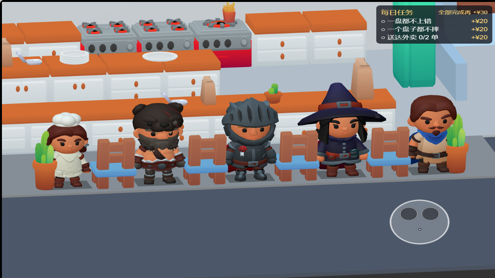
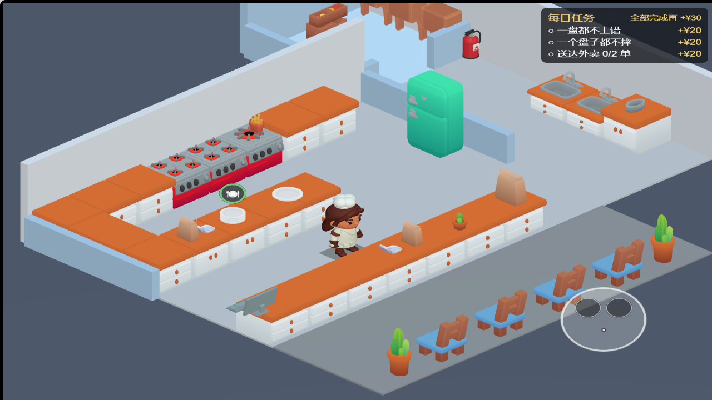
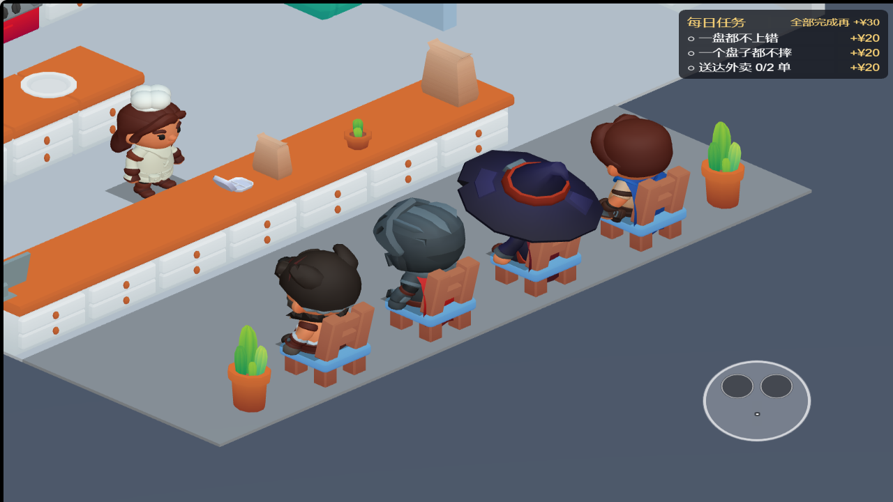
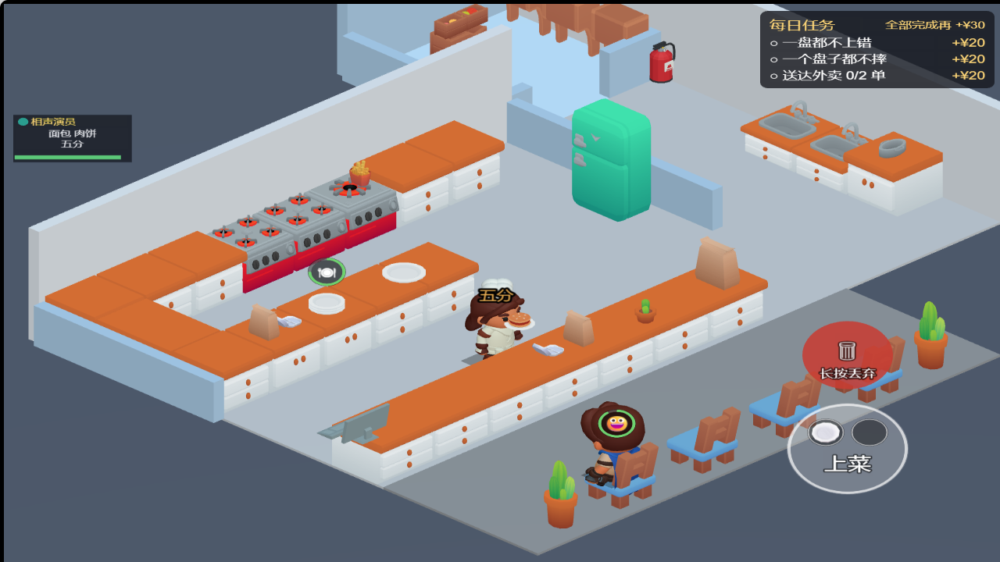

# KayKit Adventurers 人物接入（2026-10-14）

按用户选定的素材，将主角和四种顾客 / 骑手全部换为 **KayKit Adventurers Free 2.0**。此前的 Quaternius 人物已从正式素材目录移除。厨房道具继续使用 KayKit Restaurant / Furniture；厨房布局、碰撞、营业规则、镜头角度没有因本轮人物替换而改变。修改仅在本地，未提交、推送或发布。

## 人物与适配

| 游戏用途 | 原始角色 | 本项目处理 |
|---|---|---|
| 厨师 | Rogue（不戴兜帽版本） | 白色工作服、去披风、项目自制小厨师帽；帽子随头骨运动 |
| 顾客 / 骑手 | Barbarian | 保留原服装 |
| 顾客 / 骑手 | Knight | 保留原服装 |
| 顾客 / 骑手 | Mage | 保留原服装和帽子 |
| 顾客 / 骑手 | Ranger | 去除箭袋 |

保留原始大头短身比例，不对头部和身体分别拉伸。厨师含帽总高为 1.75m，符合现有镜头检查的角色高度；顾客按同一身体基准缩放，帽子高低自然不同。原始多部件网格合并为单网格 / 单材质，纹理颜色烘焙为线性顶点色；人物使用受光材质，保留表面明暗层次。

待机使用官方 `Idle_A`，行走使用 `Walking_A`。角色和动画文件的骨骼索引排列不同，因此按骨骼名称映射全部 23 根骨骼，避免错绑。`sit` 为项目生成的静态循环坐姿，适配现有 0.48m 座面，不是素材包附带的坐下动画。未加入战斗动作或武器。

## 官方来源与免费许可

- [KayKit Adventurers 官方页](https://kaylousberg.itch.io/kaykit-adventurers)，选用 **Free 2.0** 下载项，原始压缩包保存在忽略目录 `game/temp/adventurers/Free-2.0.zip`。
- 压缩包 SHA-256：`abe48f4763fba0896bab486ee9e6d08ca6b5b3884b9601f235c8847ae94dc479`。
- 原始人物路径：`KayKit_Adventurers_2.0_FREE/Characters/gltf/{Rogue,Barbarian,Knight,Mage,Ranger}.glb`。
- 原始动画路径：`Animations/gltf/Rig_Medium/Rig_Medium_{General,MovementBasic}.glb`。
- 作者 Kay Lousberg；随包 CC0 许可保存在 `game/assets/art/restaurant/LICENSE-KayKit-adventurers.txt`，允许个人、教学和商业项目使用。无需购买，未下载付费 SOURCE / EXTRA 或 Series 5。
- 模型来源、压缩包校验值、所用动画和项目改造也记录在 `game/assets/art/restaurant/manifest.json`。

## 复跑

1. `python tools/fetch-restaurant-art.py` 获取固定版本的厨房 / 家具及官方免费人物包。只重取人物时可运行 `python tools/fetch_adventurers.py`。官方文件变化会因校验值不同而停止，需要重新审核。
2. `python tools/import-restaurant-art.py` 生成模型，需要 Python 与 Pillow；通用 glTF 工具位于 `tools/gltf_assets.py`，人物处理位于 `tools/import_adventurers.py`。
3. Cocos Creator 3.8.8 导入素材，保留已存在的 `.meta`。确认五个人物的 idle / walk / sit 都使用完整片段、循环模式 2。
4. `node tools/apply-restaurant-art.mjs` 将已导入的人物应用到正式场景；版本不变时重复运行不会改动场景字节。导入和应用期间不要同时在编辑器修改场景。
5. `pnpm check`、`pnpm scene`、`pnpm layout`、`pnpm cam`、`pnpm a7`。
6. 用 Cocos 构建独立目录 `game/build/adventurers-web`，通过 HTTP 提供服务。浏览器验证：`node tools/verify-restaurant-art.cjs http://127.0.0.1:4179 game/temp/adventurers/verification --serve`。可用 `PLAYWRIGHT_MODULE` 指定外部 Playwright 模块，默认浏览器为 Edge。

浏览器脚本检查待机、行走、四种坐姿，保存正常厨房、坐姿、正面合照和端盘截图，再通过真实交互输入跑一份汉堡交付。机器人会直接移动到工位，不能代替真人导航和手机触控验收。合照和坐姿检查会临时移动人物、镜头并冻结营业，这些状态不会写回正式场景。

## 文件范围

- `game/assets/art/restaurant/actor-{chef,barbarian,knight,mage,ranger}.glb` 及 `.meta`、人物许可和 `.meta`、`manifest.json`。
- `game/assets/main.scene`：主角模型分支和四种顾客预制体引用。
- `tools/fetch-restaurant-art.py`、`tools/fetch_adventurers.py`、`tools/import-restaurant-art.py`、`tools/import_adventurers.py`、`tools/gltf_assets.py`、`tools/apply-restaurant-art.mjs`、`tools/verify-restaurant-art.cjs`。
- `tests/restaurant-art.test.ts`、`.gitignore`（忽略 Python 缓存）、`ROADMAP.md`、本文和检查配图 / JSON。
- 移除五个旧 Quaternius GLB 及 `.meta`、两份旧人物许可及 `.meta`；移除前核对正式资源中无剩余 UUID 引用，备份在 `game/temp/adventurers/quaternius-before.zip`。

同日其他聊天产生的布局和玩法修改继续保留。旧 Kenney 目录仍供旧场景和未替换的小配件使用。

## 验证结果与画面

- `pnpm check`：类型检查、逻辑层零引擎依赖检查，以及 500 项测试 / 38 文件全部通过；人物测试检查完整骨骼映射、三段循环动画、单材质与人物引用。
- scene / layout / cam / a7 全部通过。与本轮开始前的场景快照相比，302 个保留节点的位置、旋转、缩放和显隐状态相同；厨师含帽总高符合 1.75m 镜头约定。
- Cocos Creator 3.8.8 独立 Web 构建 `game/build/adventurers-web` 成功。
- 浏览器检查通过：主角待机 / 行走时间推进、四种坐姿、五种人物正面合照、完成汉堡后的端盘画面；15 次交互完成一份汉堡交付。无浏览器警告、异常或资源请求失败，结果见 [检查记录](adventurers-2026-10-14-check.json)。
- 34 个生成文件重新转换逐字节一致；场景重复应用逐字节一致；Python 语法检查和 `git diff --check` 通过。
- 正式素材目录含 68 文件，共 3,656,219 字节，包含厨房 / 家具、五个人物、贴图、许可、清单和 `.meta`；这是源素材大小，不代表微信包体。

正面合照（临时摆位）：

正常厨房视角：

坐姿与通道中的端盘检查：

## 不要报成 bug 的清单与遗留

- Adventurers 是奇幻人物包，顾客保留骑士盔甲、法师帽等原服装；厨师是项目改造的 Rogue，不是官方独立厨师角色。
- 坐姿是静态循环，没有坐下 / 起身过渡。
- 本记录对应人物替换阶段。随后完成的墙体渐隐、25° 侧转镜头、外围布景和灯光调整见 [场景画面调整](art-direction-2026-10-14.md)。
- 微信构建、真实包体审计和手机性能 / 触控验收尚未进行。
