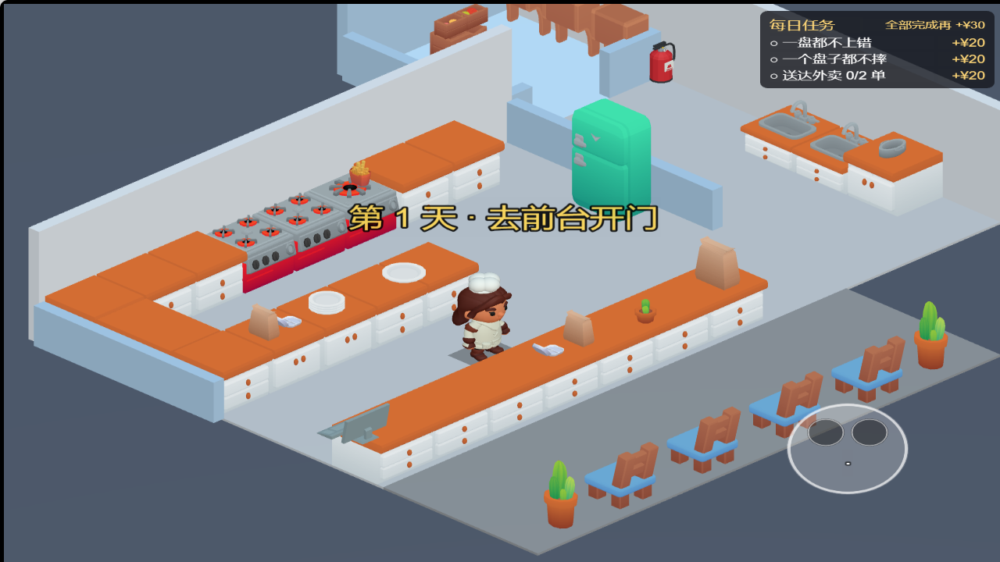
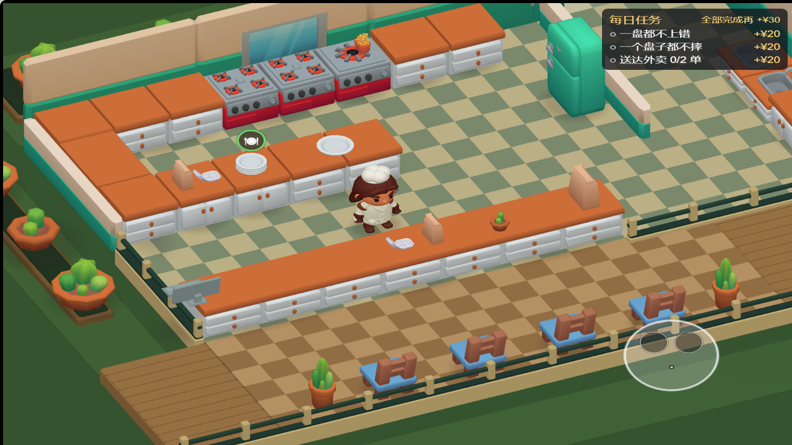
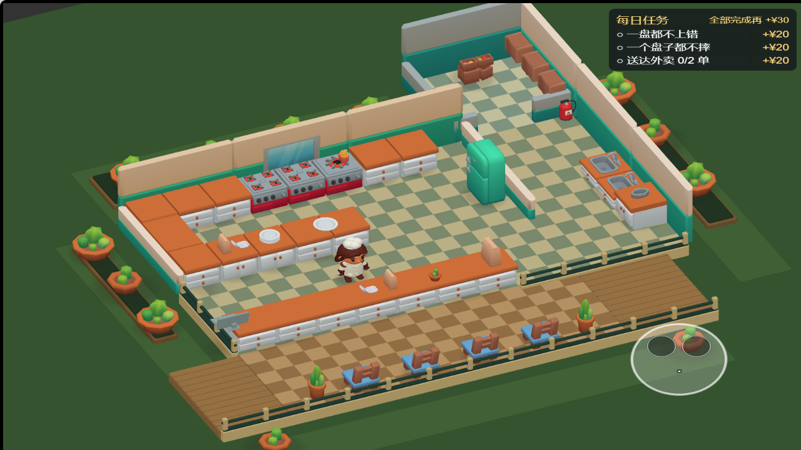
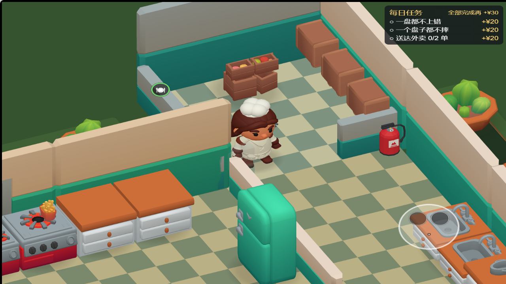
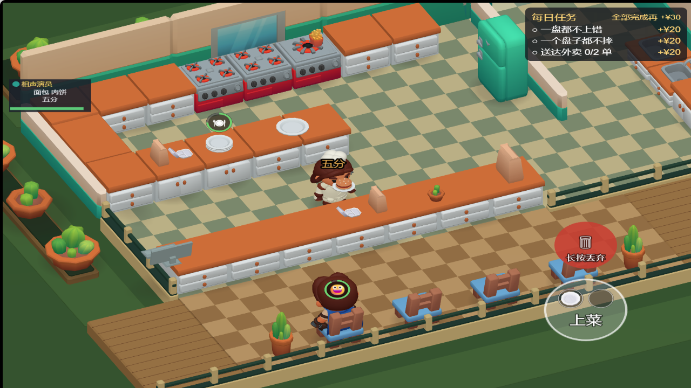
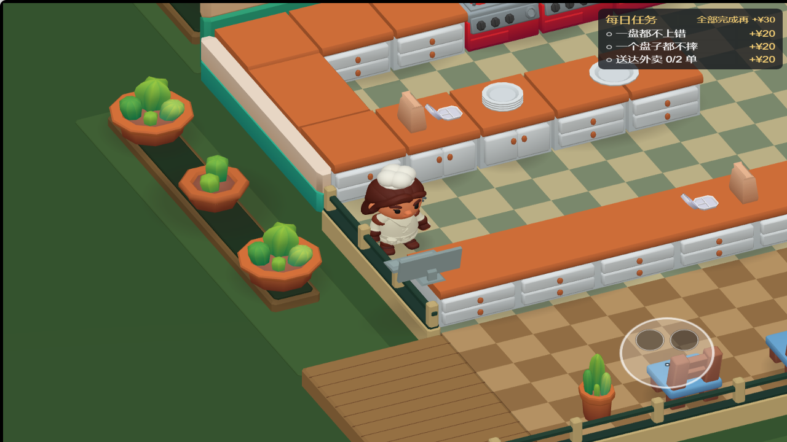
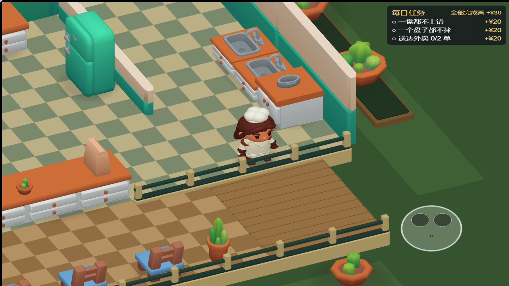

# 场景画面调整（2026-10-14）

按用户提出的四点调整正式场景：挡人墙体改为渐隐、减少 45° 斜角带来的空白、补齐墙面 / 地砖 / 外围装饰，并改善道具的受光质感。沿用用户已选的 KayKit Adventurers 人物，修改仅在本地，未提交、推送或部署。

## 已实现

- 墙体不再移动或压低：脚部 / 胸部视线被挡时，在约 0.2 秒内淡至约 22% 不透明度，离开后恢复。墙面、窗框等子网格一起处理；渐隐时关闭深度写入，保留深度测试。材质按墙实例隔离，场景销毁时释放。
- 镜头由 yaw −45°、pitch −35° 改为 yaw −25°、pitch −45°，仍为正交俯视。地面投影 / 跟随改为通用二维逆变换，场景四元数与逻辑基向量、包围跨度同步；不再依赖 x+z / x−z 的 45° 特例。
- 使用免费 Restaurant Bits 的 `wall`、`wall_window_closed` 替换墙体外观，保留所有原墙碰撞范围。后墙增加窗户，墙体具有模型自带的顶沿和墙裙。
- 使用原生 `floor_kitchen` 模块合并成厨房、东翼、冷库、顾客区四个网格。将黑白棋盘颜色烘焙为较低对比的顶点色，顾客区使用暖棕色；每一区域仅一个网格 / 一个材质。模型顶部与原有地面齐平。
- 外围改为下沉绿地和花池，撤去容易误导行走方向的小圆桌椅，使用 12 个 KayKit 绿植补齐布景；地台包边和低栏杆明确标出实际边界，无新增交互或碰撞。
- 原有 23 种厨房 / 家具道具改用受光材质，保留原始 UV 和渐变贴图，粗糙度 0.9、金属度 0；调整暖色方向光与环境光。静态家具的柔边接触阴影合并为一个网格，人物使用跟随原 Shadow 节点的柔边椭圆。
- 保留项目《M2 场景指南》§0 的限制：方向光实时阴影和场景 Shadows 均关闭。未引入天空盒贴图或物理组件。
- 装修换色继续作用于新墙面和厨房 / 东翼地砖；模型纹理与顶点色保留，换色表现为整体色调变化。

角度、配色、淡出时长、光照和装饰摆位为本轮视觉选值，不是素材作者给定的参数。镜头和灯光配置在 `tools/art-direction.json`；地砖配色和接触阴影生成在 `tools/import_art_direction.py`。

## 后续：行走边界辨识

用户反馈可走区域与不可进入区域难以分辨。此前外围与厨房共享相近的棋盘铺地，几处无墙边缘又缺少明显阻隔，导致视觉暗示与移动边界不一致。现已完成：

- 保留厨房浅色地砖、顾客区暖色地面，外围移至 y=−0.38m 的绿地；花池、地台侧面和高差共同表达不可进入区域。绿地补色块最高处为 −0.35m。
- 厨房西侧 x=−4 和东侧前沿 z=3.6 的栏杆内侧贴合真实移动边界；栏杆高约 0.65m，不挡人物上半身。顾客区前缘也增加围边。
- 去掉外围两组桌椅，补绿植花池；为现有 NPC 入口 x=6.5、出口 x=−5.5 补齐同高度暖色木地台，保留顾客 / 骑手的原进出路线。
- 新增资产判据：从 GLB 实际顶点 / 索引取出围边三角形，逐一验证其地面包围框不侵入 3821 个可达位置的厨师半径；核对围边与实际 `FLOOR_BOUNDS` 一致，验证外围地面确实下沉。
- 本轮开始前与修改后，排除脚本生成分支后的 286 个既有节点路径、ID、位置、旋转、缩放和激活状态逐项一致。工位、碰撞、镜头和人物比例均未改动。
- Web 构建、两处边缘近景、墙体渐隐与恢复、装修换色、4:3 / 19.5:9 和一份汉堡交付复验通过。首次浏览器检查有一张旧 PNG 报 `ERR_NO_BUFFER_SPACE`；文件存在且独立 HTTP 请求为 200，随后完整重跑零异常 / 警告 / 请求失败。

本轮文件：`tools/import_art_direction.py`、`tools/art-direction.json`、`tools/apply-art-direction.mjs`、`tools/verify-art-direction.cjs`、`tests/restaurant-art.test.ts`、`game/assets/main.scene`；素材目录中的 `floor-terrace.glb` / `.meta`（保留旧资源名，内容改为绿地）、`site-boundaries.glb` / `.meta`、`contact-shadows.glb`、`manifest.json`；本记录 / 检查 JSON / 最新实景图与 ROADMAP。人物资产逐字节不变。备份和构建日志位于 `game/temp/walkable-boundary/`。

高差、围边配色与栏杆高度属于本轮视觉选值；未新增付费素材。手机触控和性能仍待实测。

## 来源与许可

墙板、窗墙、地砖及最初的小圆桌椅均来自已缓存的 [KayKit Restaurant Bits](https://kaylousberg.itch.io/restaurant-bits) 免费 CC0 包；绿植来自 [KayKit Furniture Bits](https://kaylousberg.itch.io/furniture-bits) 免费 CC0 包。无新增付费下载。固定版本、原始缓存位置和许可证沿用 `docs/restaurant-art-2026-10-14.md`。

地砖合并 / 重配色、绿地 / 花池 / 地台围边和接触阴影为项目生成内容；人物来源与动画适配沿用 `docs/adventurers-2026-10-14.md`。这些资产的来源和处理方式也记录在 `game/assets/art/restaurant/manifest.json`。

## 验证

- `pnpm check`：504 项测试 / 38 文件通过，包含逻辑层无引擎依赖检查和 TypeScript 检查。新增材质受光、地砖尺寸 / 合批、渐隐时序判据。
- `pnpm scene`、`pnpm layout`、`pnpm cam -- --export-navigation`、`pnpm a7` 通过。镜头扫描 3821 个可达位置和四种屏幕比例，人物均完整可见，最小余量约 0.48m。
- 首轮画面调整保留全部 335 个原节点 / 场景路径，仅改变 Main Camera 和 Main Light 的变换；本轮与开始前对比，排除生成分支后的 286 个节点变换和 ID 全部一致。工位、通道、人物比例、碰撞和营业规则未改变。部分旧节点的 32 位十六进制 ID 规范为 Cocos 压缩 UUID，内部引用检查通过。
- Cocos Creator 3.8.8 独立 Web 构建 `game/build/art-direction-web` 成功。正常厨房测试帧为 95 次绘制调用 / 37051 三角形，此数字不是手机性能测试。
- 浏览器在真实可达点 `(5.75, −3.55)` 检测到冷库隔墙渐隐，材质 alpha=56/255、深度写入关闭；全体墙的位置 / 缩放逐项一致，离开后全部恢复 alpha=255。装修换色覆盖可见子网格，4:3 与 19.5:9 渲染比例及镜头高度检查通过。
- 人物待机、行走、四种坐姿、端盘与一份汉堡交付通过，交付涉及 15 次真实交互输入。浏览器警告、异常和加载失败均为 0。机器人会直接定位到工位，因此不能代替真人导航验收。
- 92 个正式素材目录文件重生成逐字节一致，场景重复应用逐字节一致；该目录共 4561456 字节，不能当作微信构建包大小。
- 机器可读结果：[检查记录](art-direction-2026-10-14-check.json)。

## 复跑

1. `python tools/import-restaurant-art.py`，需要 Python / Pillow 与已下载的免费素材缓存。
2. Cocos Creator 3.8.8 导入新资产，保留 `.meta`；再运行 `node tools/apply-restaurant-art.mjs` 和 `node tools/apply-art-direction.mjs`。应用顺序保持一致，期间避免在编辑器改同一场景。
3. 执行上述 pnpm 判据；`pnpm cam -- --export-navigation` 会生成浏览器验证需要的可达位置 JSON。
4. 构建 Web 后提供本地 HTTP 服务。当前预览为 `http://127.0.0.1:4180`。
5. `node tools/verify-art-direction.cjs http://127.0.0.1:4180 game/temp/art-direction/verification`；再执行 `node tools/verify-restaurant-art.cjs http://127.0.0.1:4180 game/temp/art-direction/gameplay --serve`。可用 `PLAYWRIGHT_MODULE` 指向外部 Playwright 安装，默认使用 Edge。

验证脚本会临时冻结人物 / 营业、改变相机和画布尺寸来检查细节；这些临时状态不写回场景。备份在忽略目录 `game/temp/art-direction/before.zip`，构建与诊断日志也保留在该目录。

## 文件范围

- `game/assets/main.scene`，`scripts/WallCutaway.ts`、`scripts/StationView.ts`，`logic/camera.ts`、`logic/decor.ts`。
- `game/assets/materials/M_{Floor,FloorOut,FloorOuter,FloorStore,Wall,ColdWall}.mtl`。
- `game/assets/art/restaurant/`：23 种既有道具转为受光材质，新增四种墙面 / 桌椅资产（桌椅现未放置）、四个地砖网格、两个场地网格、两种接触阴影及对应 `.meta`，更新 manifest；人物文件逐字节不变。
- `tools/import-restaurant-art.py`、`tools/import_art_direction.py`、`tools/apply-restaurant-art.mjs`、`tools/apply-art-direction.mjs`、`tools/art-direction.json`、`tools/camcheck.ts`、`tools/scene-spec.ts`、`tools/verify-art-direction.cjs`。
- `tests/camera.test.ts`、`tests/occlusion.test.ts`、`tests/scene-layout.test.ts`、`tests/restaurant-art.test.ts`，本记录 / 图片 / JSON、ROADMAP 和人物记录的后续状态说明。

## 不要报成 bug 的清单与遗留

- 墙体淡出保留轮廓，不做整屏模糊；透明度约 22%，碰撞和高度保持不变。
- 下沉绿地、花池为不可进入的布景；暖色顾客区供 NPC 使用，厨师范围由前台 / 栏杆与原边界共同表达。栏杆只补视觉阻隔，不扩建可玩范围。
- 柔边阴影是贴地网格，不是实时光照阴影，也没有复刻官方展示图的离线渲染 / 环境遮蔽效果。
- 灯光与材质现在更统一，但人物帽子、静态坐姿等既有适配保持不变。
- 微信构建、包体审计、手机性能与触控仍待实测。

## 实景

修改前：

正常跟随镜头：

全景使用临时拉远镜头，方便检查外围布置：

边缘近景：

