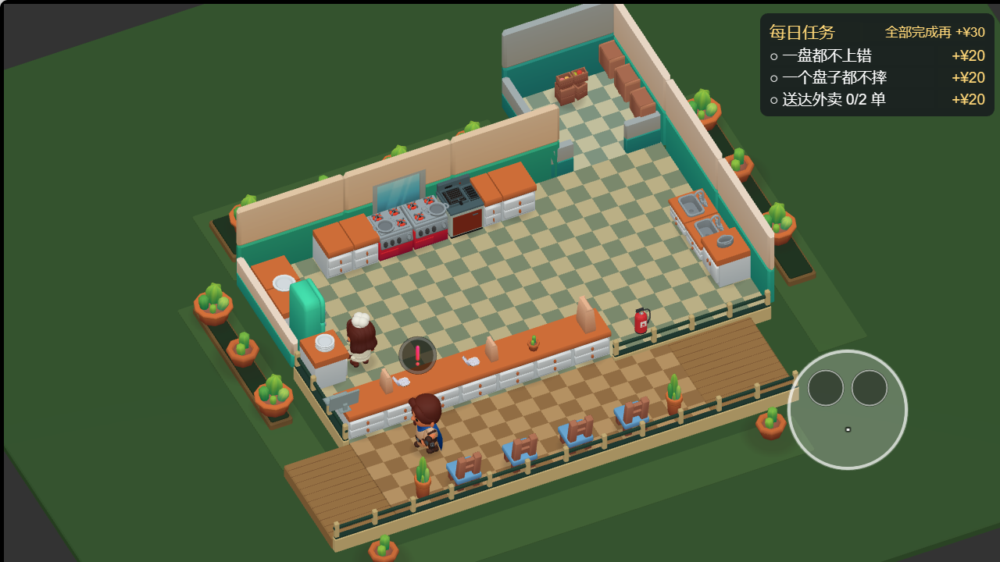

# 常用工位默认位置调整

2026-10-15。用户反馈冰箱和盘子的默认位置仍靠角落，本轮把两者集中到左侧工位中段。

| 内容 | 当前默认位置 x / z |
| --- | --- |
| 冰箱 | -3.5 / 0 |
| 取盘架 | -3.5 / 1 |
| 制作台 | -3.5 / -1.5 |

制作台两段柜体与台面盘子一起移动；其他工位、中央空地、固定墙柜沿用上一版。接触阴影按更新后的实际场景重新生成。



复跑判据：

```powershell
pnpm check
pnpm layout
pnpm scene
pnpm cam
$env:PLAYWRIGHT_MODULE='C:/Users/12255/.cache/codex-runtimes/codex-primary-runtime/dependencies/node/node_modules/playwright'
node tools/verify-open-centre.cjs 'http://127.0.0.1:4183/?v=frequent-stations-20261015' game/temp/frequent-stations-verification-final
node tools/check-wechat-package.mjs game/build/kitchen-chaos-frequent-stations-wechat-20261015
```

检查结果：519 项测试 / 40 文件通过，类型与零引擎依赖通过。场景结构、碰撞与可达性通过；默认布局完成率 91.8%、后期 84.3%、idle 偏差 0.6%，原默认难度闸门通过。地图仍有 4840 个可达采样点，冷库门与前台东端通道净宽 1.5m。

浏览器通过真实摇杆移动、动作键和菜单点击完成取料、煎肉、制作、正确送餐、洗盘、晾盘、还盘及灭火器取还。送餐 served=1、wrong=0；完整运行记录在 `frequent-stations-2026-10-15-check.json`。检查包含两个可见锅、已取消的灭火器悬浮文字、三个新工位阴影锚点，以及旧角落/中央无遗留阴影。先验新位置存在，再验旧位置不存在，避免旧构建误过。最终浏览器异常、警告、失败请求均为空。

Web 构建：`game/build/open-centre-web`，本地预览 `http://127.0.0.1:4183/?v=frequent-stations-20261015`。微信构建：`game/build/kitchen-chaos-frequent-stations-wechat-20261015`。ZIP：`game/build/packages/kitchen-chaos-frequent-stations-wechat-20261015.zip`，170 个文件和构建目录逐字节一致。主包 2,253,532 字节；internal 分包 405,194 字节，main 分包 5,988,383 字节，总量 8,647,109 字节，主包/总包预算通过，未配置远程 bundle。实际报告见 `frequent-stations-2026-10-15-package.json`。

文件清单：`tools/scene-spec.ts`、`game/assets/main.scene`、`game/assets/art/restaurant/contact-shadows.glb`、`tests/scene-layout.test.ts`、`tests/restaurant-art.test.ts`、`tools/verify-open-centre.cjs`、当前截图/JSON/本文；另更新自定义布局设计稿、新增实现计划和 ROADMAP 状态。

## 不要报成 bug 的清单

- 全部工位仍贴四周，中央空地保留；这不是把设备放回中央岛台。
- 灭火器悬浮文字已移除，但取放/灭火动作和必要的操作按钮文字保留。
- 默认布局没有通过改客流、加工时间或移速来补偿位置变化。
- 自定义装修目前只有已认可的设计和待审实现计划，尚未出现游戏入口。
- 月度房租/水电/税费、经营日期、破产惩罚与奖励尚未接入。

遗留：微信手机实机拖动和多指触控属于后续自定义布局实现的试玩验收；本轮微信工程构建/包资源验证不能替代真机试玩。用户已批准自定义布局计划和本会话执行方式，随后要求暂停并提交 Git；编辑器停在 Task 1 之前，本文及全部源码/验收证据随本次本地提交保存，未推送/部署/同步。构建目录与 ZIP 沿用现有忽略规则保留本地。
