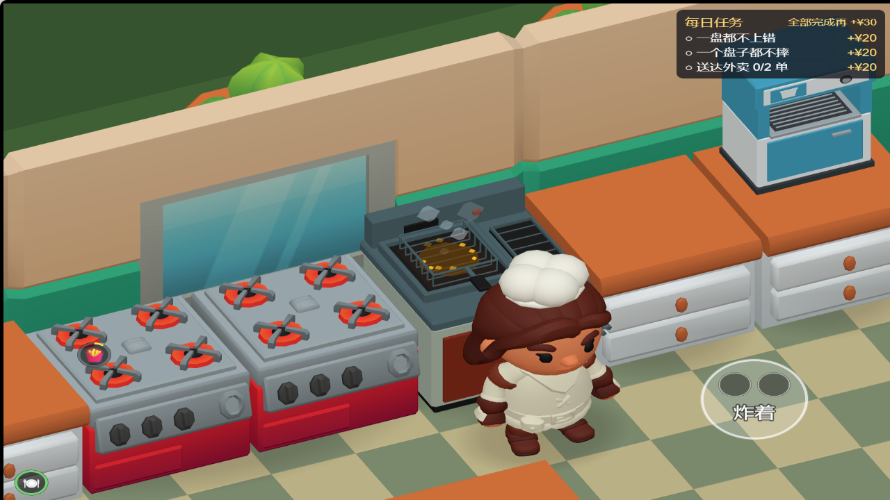
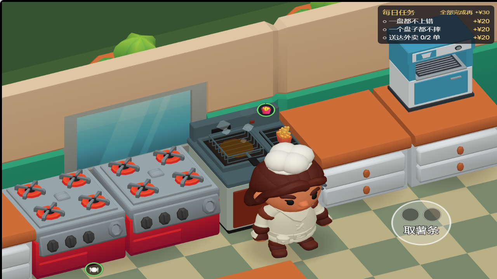

# 薯条工位修正与构建 · 2026-10-14

原炸锅工位使用单头炉模型，并常驻一盒成品薯条。现替换为原创低多边形炸锅：左侧油槽与炸篮、右侧独立出餐托盘。成品只在 `fryer.stage === 'ready'` 时显示，取走、烧焦和空锅时隐藏；沸腾气泡改为油色并对齐左侧油槽。模型带切角边缘和受光粗糙材质，无外部下载或付费素材。

工位与碰撞位置不变，未移动烤肉台或修改炸制 / 烧焦时长。与修改前快照相比，保留节点中只有原炸锅模型缩放与薯条的摆放 / 显示状态发生变化。

## 验证

- `pnpm check`：505 项 / 38 文件通过，含类型检查。
- `pnpm scene`、`pnpm layout`：通过；3821 个可达点 / 13 个交互工位、通道与难度判据保持通过。
- `node tools/verify-workstation-effects.cjs http://127.0.0.1:4180 game/temp/fryer-fix/verification`：通过所有工位状态检查；新增空锅 / 炸制隐藏成品、炸好显示托盘薯条、烧焦隐藏、取走清空；浏览器零异常 / 警告 / 请求失败。
- 炸锅生成器再次生成的 GLB 与正式资产逐字节相同；场景应用器重跑后场景逐字节不变。
- Web Desktop 和微信小游戏实际构建；最终产物清单、SHA-256 与配置保存在同目录 `fryer-fix-2026-10-14-check.json`。

## 构建与打包

- Web 输出：`game/build/art-direction-web/`，预览 `http://127.0.0.1:4180/`；压缩包 `game/build/packages/kitchen-chaos-web-20261014.zip`。解压后通过 HTTP 服务访问 `index.html`。
- 微信输出：`game/build/kitchen-chaos-wechat-20261014/`；压缩包 `game/build/packages/kitchen-chaos-wechat-20261014.zip`。解压后在微信开发者工具中导入包含 `project.config.json` 的目录。
- 两种构建均使用 Cocos Creator 3.8.8，入口 `db://assets/main.scene`；Web 为调试预览构建，微信为非调试构建，设备方向 `landscapeRight`，沿用已有项目 appid。微信产物使用独立目录。
- 构建命令：CocosCreator.exe `--project <game绝对路径> --build configPath=<构建配置绝对路径>`；对应配置副本在 check JSON 中。

## 文件清单

- `tools/build-fryer.py`、`game/assets/art/restaurant/fryer.glb` / `.meta`、`manifest.json`：原创炸锅生成与资产。
- `tools/import-restaurant-art.py`、`tools/apply-restaurant-art.mjs`、`game/assets/main.scene`：可复现资产接入与托盘摆放。
- `game/assets/scripts/StationView.ts`、`WorkstationEffects.ts`：成品显隐和油槽动画锚点。
- `tests/restaurant-art.test.ts`、`tools/verify-workstation-effects.cjs`：回归判据。
- `ROADMAP.md`、本记录 / check JSON / frying 与 ready PNG：验收与交接。
- `game/build/art-direction-web/`、`game/build/kitchen-chaos-wechat-20261014/`、`game/build/packages/`：本地构建 / 压缩包，按既有忽略规则不纳入版本管理。

## 不要报成 bug 的清单与遗留

- 炸锅在购买前继续作为静态布景显示；购买解锁逻辑未改，成品受解锁和实际状态共同控制。
- 原 `kitchenStoveElectric` 节点名为兼容既有场景工具保留，其子模型已是独立炸锅；薯条纸盒继续沿用项目已有资产。
- 模型是原创适配件，不是 KayKit 官方素材；旧单头炉文件保留在素材目录，正式炸锅不再引用。
- 微信工程已构建，但主包约 8.24 MiB，超过项目 4 MiB 预算，不能当作完成发布验收的版本。尚需独立处理资源分包 / 优化及真机验证；本次未上传或发布。
- 旧包体脚本报告部分动画二进制为疑似孤儿；本次没有据此删除资源，以实际目录文件总量记录包体。

## 实景

