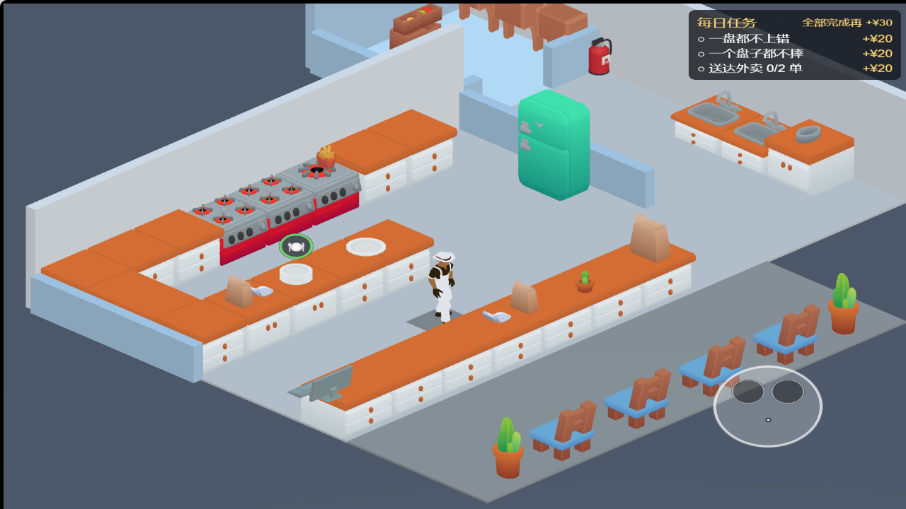
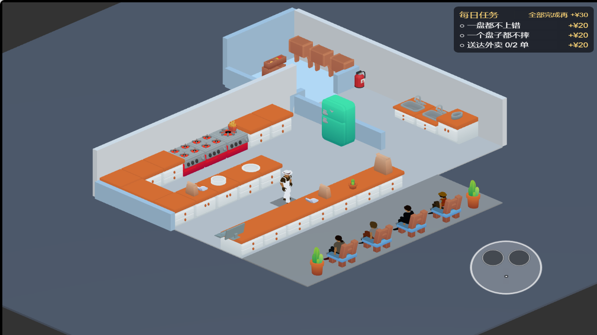
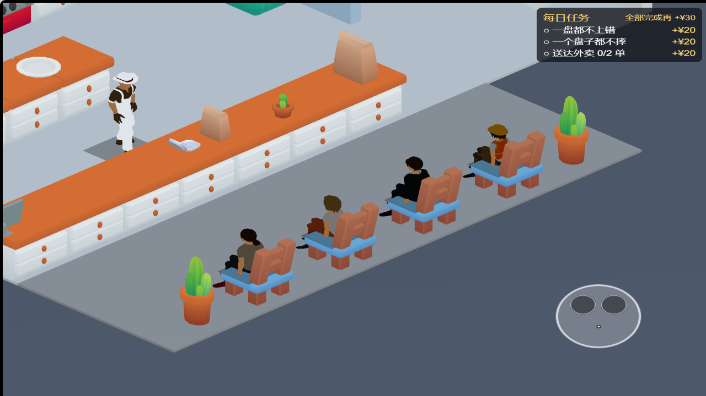

# KayKit / Quaternius 素材替换（2026-10-14）

> 本文记录当日第一轮素材接入。人物随后已按用户要求改为 KayKit Adventurers Free 2.0，当前人物与复跑流程以 [最新记录](adventurers-2026-10-14.md) 为准；下文人物截图和 Quaternius 说明属于历史状态。

正式场景已换用 KayKit 厨房、食材和家具，以及 Quaternius 人物。保持同日完成的回折半岛布局、通道、出生点、碰撞、镜头和营业规则。当前仅有本地修改，未提交、推送或发布。

## 替换范围

- 50 个静态模型实例：橱柜、灶台、水槽、冰箱、冷库箱子、盘子、锅、主要汉堡配料、架子、四把座椅和盆栽。
- 主角改为 Quaternius Farmer，围裙 / 工作服与帽子改为白色；它是改色后的 Farmer，并非另行购买的厨师模型。
- 四种顾客 / 骑手外观：男性休闲装、女性休闲装、男性西装、女性工作装。
- 人物保留原素材的待机、行走动画，另生成适配现有 0.48m 座面高度的静态循环坐姿；`sit` 是本项目生成的姿势，不是原作者提供的动画。
- 洋葱运行时预制体也切换到 KayKit。原有食材节点名保留，便于 `BurgerStack` 继续取模、缩放与变色。

导入库包含 23 个道具 GLB、5 个人物 GLB、两张 512×512 共享贴图、素材清单和四份原始许可；连同 `.meta` 共 70 个文件，6,313,228 字节。这是源素材大小，不代表微信最终包体大小。场景中未使用的少量候选道具保留在库中。

## 来源与许可

以下选用内容均附 CC0 许可，可用于个人学习；许可也允许商业项目使用。本轮无需付费，未使用付费的 KayKit Characters — Series 5。

| 素材 | 官方来源 | 本轮下载版本 |
|---|---|---|
| KayKit Restaurant Bits 1.0 | [作品页](https://kaylousberg.itch.io/restaurant-bits)、[官方仓库](https://github.com/KayKit-Game-Assets/KayKit-Restaurant-Bits-1.0) | `153c8a7535b48237854cb54ff6890679f8c574d1` |
| KayKit Furniture Bits 1.0 | [官方仓库](https://github.com/KayKit-Game-Assets/KayKit-Furniture-Bits-1.0) | `96d5930a8dbdb363409bbc2d3341718b00e17c9c` |
| Quaternius Ultimate Modular Men / Women | [男性包](https://quaternius.com/packs/ultimatemodularcharacters.html)、[女性包](https://quaternius.com/packs/ultimatemodularwomen.html) | 从公开 CC0 [镜像仓库](https://github.com/agentkaerf/FreeModels)取得 glTF 与随包许可，固定 `db3df04d1e4714298a09510b26fb6de6645138a2` |

人物原文件路径为 `Ultimate Modular Men- Feb 2022/Individual Characters/glTF/{Farmer,Casual_2,Suit}.gltf` 与 `Ultimate Modular Women - April 2022/Individual Characters/glTF/{Casual,Worker}.gltf`。

许可原文保存在 `game/assets/art/restaurant/LICENSE-*.txt`。作者分别为 Kay Lousberg 与 Quaternius。镜像是分发来源，不作为原创作者署名。

## 接入与复跑

1. `python tools/fetch-restaurant-art.py`：从上述固定版本获取源文件，存入被忽略的 `game/temp/art-swap/`。
2. `python tools/import-restaurant-art.py`：需要 Python 与 Pillow。生成 GLB、共享贴图与许可。道具底部居中，人物高度归一化为 0.875，沿用场景人物二倍缩放。合并人物网格为单材质顶点色，材质使用 unlit。
3. 用 Cocos Creator 3.8.8 打开 / 导入项目，生成 `game/library`；**已有 `.meta` 必须保留**。五个人物的 idle/walk/sit 导入片段均设置为完整区间循环。
4. `node tools/apply-restaurant-art.mjs`：读取 Cocos 已导入的预制体，替换正式场景模型；逻辑容器不移动。已有素材版本未变时重复运行不会改动场景字节。
5. `pnpm check`，以及 `pnpm scene`、`pnpm layout`、`pnpm cam`、`pnpm a7`。
6. 通过 Cocos 构建 Web 桌面调试版并以 HTTP 服务打开。安装 Playwright 与 Edge 后，可执行 `node tools/verify-restaurant-art.cjs http://127.0.0.1:4178 game/temp/art-swap/verification --serve`；若 Playwright 不在项目依赖中，通过 `PLAYWRIGHT_MODULE` 指定其模块路径。脚本默认使用 Edge，`BROWSER_CHANNEL` 可覆盖。

浏览器检查会临时冻结营业、摆出四种坐姿并移动相机以截图，之后重新载入实际场景做汉堡流程检查；这些检查状态不会写回场景文件。汉堡机器人通过真实交互输入完成取料、煎肉、组装和交付，但会直接移动到工位，不代替真人导航验证。

## 验证结果

- `pnpm check`：500 项测试 / 38 文件通过，包含三个新增素材接入测试；类型检查、逻辑层无引擎依赖检查通过。
- scene / layout / cam / a7 全部通过。对照替换前快照，25 个 `Prop_*` 容器的位置、旋转、缩放和显隐状态无变化；`StationView.ts` 与素材替换开始前完全一致。
- Cocos Creator 3.8.8 独立 Web 构建 `game/build/restaurant-web` 完成；编辑器重建产物保持忽略。
- 浏览器：待机与行走时间推进正常，四种人物坐姿显示正常；无浏览器警告、异常或素材请求失败。
- 一个汉堡实操流程通过，15 次交互输入，游戏内约 16 秒交付；没有为适配测试修改营业规则。
- 从固定来源重新生成素材，输出与当前素材逐字节一致；重复应用场景也逐字节一致。`git diff --check` 通过。
- 机器可读浏览器结果见 [验证记录](restaurant-art-2026-10-14-check.json)。

## 画面

正常跟随镜头：

布局和四种人物姿势检查，镜头临时拉远：

## 本轮文件清单

- `game/assets/main.scene`：模型分支、人物 / 洋葱资源引用与主角初始待机。
- `game/assets/art/restaurant.meta`、`game/assets/art/restaurant/*`：模型、贴图、许可、清单及所有 `.meta`。
- `tools/fetch-restaurant-art.py`、`tools/import-restaurant-art.py`、`tools/apply-restaurant-art.mjs`、`tools/verify-restaurant-art.cjs`：下载、转换、接入和浏览器验证。
- `tests/restaurant-art.test.ts`：道具引用、人物骨骼 / 动画 / 材质、四种顾客与座椅断言。
- `tests/scene-layout.test.ts`：在原布局测试中，将冰箱高度的测量源切换到新 GLB，包含 glTF 节点变换。
- `ROADMAP.md`、本记录、三张配图、验证 JSON。

同日布局工作已经产生的其他文件改动均保留，不归入本轮素材替换。

## 不要报成 bug 的清单

- 旧 Kenney 资产目录保留，以免破坏旧展示场景与其他资源引用。主场景仍保留打包袋、薯条、餐盒、收银键盘 / 屏幕，以及一个已隐藏的冷库门框；本轮是厨房主体、食材与人物替换，没有宣称清零全部 Kenney 配件。
- 项目自制的培根、酸黄瓜、饮料机和灭火器继续使用。UI、图标与音效没有更换。
- 白色主角来自 Farmer 改色；坐姿是静态循环。后续可在用户选定 Series 5 后另行替换人物，但当前版本没有购买依赖。
- 座椅从旧长凳换成四把椅子，保持原四个座位中心；椅子朝北面对柜台。
- 模型沿用原逻辑容器与碰撞布局，部分橱柜按原占地做非等比适配。没有据此改变厨房动线。
- 全景和人物截图的临时相机、冻结人物状态只用于检查。

## 遗留

微信构建、实际主包 / 分包审计与手机性能、触控验证尚未进行。桌面通过不等同于真机验收。付费 Series 5 未下载或接入；其他未覆盖配件可在后续选定同风格素材后继续替换。
