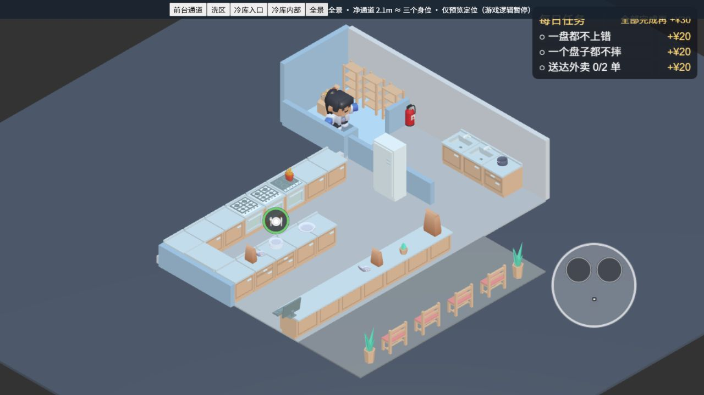

# 回折半岛场景调整 · 2026-10-14

按用户确认的回折半岛方案修改正式 `game/assets/main.scene`。半岛由左侧回折柜连接后排厨房，右端开放；洗区沿右墙布置，冷库接在右后方。现有模型复用，未新增美术资产。

## 布局与通道

世界坐标单位为米，北侧为负 Z。最终数值由 `tools/scene-spec.ts` 管理；运行时饮料机、灭火器和装饰位置由 `game/assets/logic/scene-layout.ts` 管理。

| 区域 / 工位 | 位置或范围 | 用途 |
| --- | --- | --- |
| 主厨房 | X −4…5，Z −3…3.6 | 后排烤炉、左侧回折柜、半岛、前台 |
| 回折柜 | X −4…−3，Z −3…0.5 | 接通后排与半岛，消除孤立岛台 |
| 半岛 | X −3…1，Z −0.5…0.5 | 打包、盘子、两米制作台 |
| 烤炉 | (0, −2.5)，2×1 | 双烤位 |
| 冰箱 | (4.5, −0.5)，1×1 | 朝厨房开放；避开冷库入口视线 |
| 前台 | X −4…3.5，Z 2.6…3.6 | 点单、堂食出餐、外卖取餐 |
| 洗区 | X 5…8，Z −3…3.6 | 两段水池接晾架，操作面朝西 |
| 冷库 | X 5…8，Z −6…−3 | 北侧补货箱，东侧货架 |
| 冷库门洞 | X 5.5…7，Z −3.1 | 从洗区进出 |
| 顾客区 | X −4…5，Z 3.6…6.6 | 保留四个等候座位与盆栽 |
| 玩家开局 | (0, 1.55) | 半岛与前台之间，避免生成在制作台内部 |

净宽：烤炉与半岛 **1.5m**，半岛与前台 **2.1m**，洗区主通道 **1.8m**，冷库门洞 **1.5m**，前台东端厨房出口 **1.5m**。玩家碰撞直径沿用 **0.7m**。

用户补充要求组装台与前台约三个身位：前台整排及顾客区向正 Z 外移 **0.6m**，净宽从 1.5m 增到 **2.1m = 3 × 0.7m**。同步延长主厨房、东翼地板和东墙，更新移动边界、出生点与镜头跨度。`pnpm layout` 单独守住三个身位的净宽要求。

冷库后置使可走地板成为 L 形；隐藏碰撞块排除外接矩形中没有地板的角落。货架也有独立碰撞块，不能穿过架子走到外墙边。

## 镜头与有意调整

- 沿用正交斜视相机、−45° 偏航和 −35° 俯角，重算内容跨度与跟随边界。窄屏仍按原规则拉远。
- 新隔墙沿用 `WallCutaway`，遮住角色时降到原高的 12%。冷库入口的高门框隐藏，保留低墙门洞。
- 实景检查发现冰箱放在 (4.5, −1.5) 会挡住冷库门口的角色下半身，最终向前移到 (4.5, −0.5)。回归检查读取 GLB 的实际高度，校验门洞与冷库内部视线。
- 原第二段水池关闭；现启用并统一为一米模块，对齐两米洗区碰撞范围。仍共用一个洗碗交互与进度。
- 饮料机抬到后排柜台上方。玩家影子、交互规则、厨师速度和难度参数沿用原实现。
- 顾客区保留原四座，未采用此前概念图的减座草案。

## 文件清单

- `game/assets/main.scene`：地板、墙体、工位、模型、出生点及克隆结构。
- `game/assets/logic/scene-layout.ts`、同名 `.meta`：运行时附加工位位置。
- `game/assets/scripts/StationView.ts`：读取实际出生点、共享附加工位位置与饮料机高度。
- `game/assets/logic/movement.ts`、`camera.ts`：移动外接边界、镜头跨度。
- `game/assets/logic/sim.ts`：可选绕行距离矩阵，供布局难度检查使用；默认模拟仍用原直线距离。
- `tools/scene-spec.ts`、`sceneapply.ts`、`scenedump.ts`：规格、写入及位置 / 旋转 / 可见性检查；保留场景原尾换行。
- `tools/prepare-peninsula.mjs`：可重跑的缺失结构创建与模型对齐。
- `tools/layout-navigation.ts`、`layoutcheck.ts`、`camcheck.ts`：考虑墙体、柜台、货架的可达区域和绕行检查。
- `tests/scene-layout.test.ts`、`camera.test.ts`、`occlusion.test.ts`：布局集成回归、宽屏边界与旧测试说明。
- `ROADMAP.md`、本文：当前断点与调整记录。
- 五张 `docs/scene-layout-2026-10-14-*.png`：正式场景的 Web 实景截图。

## 验证与复跑

从仓库根目录执行：

```powershell
pnpm check
pnpm scene
pnpm layout
pnpm cam
pnpm a7
git diff --check
```

- `pnpm check`：37 文件、497 项测试通过，含类型检查与逻辑层零引擎依赖检查。
- 布局：0.1m 网格中 **3821 个可达采样点、13 个交互工位**；所有工位都有可达且无遮挡的接近位置。负向测试关闭冷库门洞后，补货工位确实不可达。
- 使用真实移动解算器逐步走过半岛端头、洗区通道与冷库门洞，无碰撞阻挡。
- 20 天 × 32 种子模拟：M1 基线完成率 92.7%、后期 85.9%、空闲 72.6 秒；本布局 93.4%、89.6%、74.3 秒。空闲偏差 **+2.4%**、后期完成率 **+3.7 个百分点**，仍在 ±10% / ±5 个百分点验收范围内，带外天数为 0。
- 镜头几何检查：4:3、16:9、19.5:9、20:9 全部通过，角色包围盒最小画面余量 **0.44m**，高于 0.3m 下限。20:9 在约 24% 可达采样位置看不到烤炉，多位于外围区域；未宣称全程看到全部工位。

导航距离以可达网格和工位接近区计算，保留工位中心端点成本，适用于与旧 M1 模拟对比；不是真人操作时长或完整寻路 AI。镜头检查中的“完整可见”仅指画幅边界，墙体和冰箱遮挡另有回归及实景检查。

场景结构需要重新生成时，关闭 Cocos 编辑器，再执行 `node tools/prepare-peninsula.mjs` 和 `pnpm scene:apply --write`。已有结构会复用，保留序列化引用与原节点 ID。

本机 Cocos Creator 3.8.8 使用独立输出目录 `game/build/peninsula-web`，按[官方命令行构建文档](https://docs.cocos.com/creator/3.8/manual/en/editor/publish/publish-in-command-line.html)构建；构建产物、临时定位控制和日志均在忽略目录内，不进入源码。最终构建与截图结果见下方。

## 实景检查与遗留

Cocos Creator 3.8.8 在通道扩大后重新完成 Web 构建，已加载该产物检查 16:9 前台通道 / 全景、洗区、冷库门口和内部，以及 20:9 冷库门口。五张实景截图均更新到 2.1m 通道版本。浏览器检查阶段的 warning / error 记录为空。构建器提示现有 `mainBundleCompressionType` 参数回退到默认 `merge_dep`；项目脚本、引擎和最终构建均完成，未改动范围外的构建设置。本次构建未产生 `information.json` 差异。

结构创建脚本及场景写入脚本重跑后，`main.scene` SHA-256 完全一致。临时定位控制已清理；保留独立 Web 产物、检查日志与本地预览服务。



全景截图使用临时拉远镜头展示整体布置；其他截图使用正常跟随镜头，临时冻结角色定位进行检查，不代表完整营业实操。

- [洗区](scene-layout-2026-10-14-wash.png)
- [前台通道：净宽 2.1m](scene-layout-2026-10-14-front-gap.png)
- [冷库门口](scene-layout-2026-10-14-entrance.png)
- [冷库内部](scene-layout-2026-10-14-cold-room.png)

本次为本地场景调整，未提交、推送或发布。微信构建、包体审计和手机触控 / 性能验收仍按原交接继续；桌面预览与几何检查不能代替真机验收。
