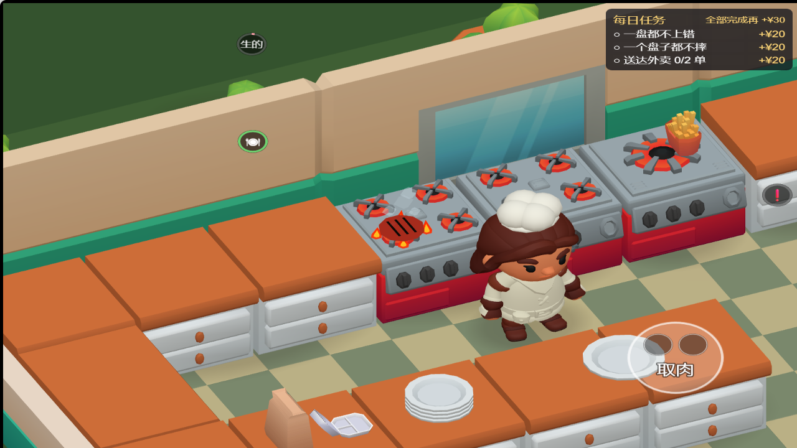
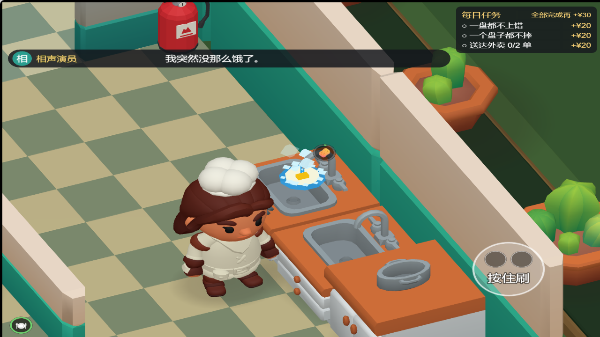
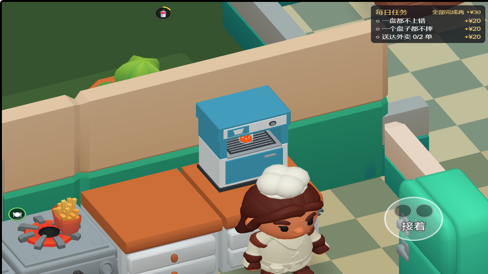
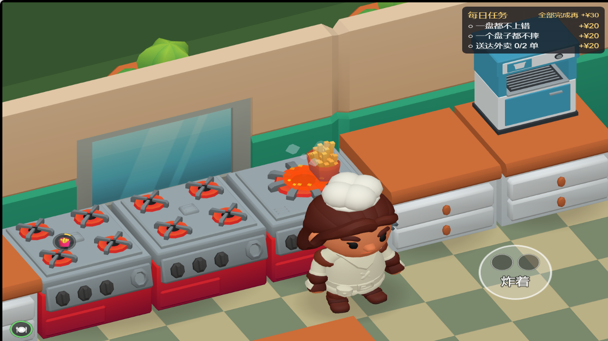

# 工位交互动画 · 2026-10-14

已在正式场景的 `StationView` 生命周期中接入动画，读取现有厨房状态，不改变玩法计时、采购解锁、碰撞和存档格式。无需额外模型或付费素材。

| 工位 | 效果与停止条件 |
| --- | --- |
| 烤肉 | 有肉的炉头出现跳动火苗、肉饼和热气；熟度改变肉色，烤焦后冒黑烟；失火时火苗变大，灭火后清除 |
| 洗碗 | 浸泡时出水，泡好后停水；按住刷洗时水流、移动海绵和泡沫一起活动；松手立即停刷洗，完成后转晾架水汽 |
| 饮料 | 出液口液柱、随真实进度升高的液面和杯子；接满停流，取走撤杯；溢出显示水迹和滴液，擦除后清空 |
| 炸锅 | 炸制时气泡翻动，完成后停止沸腾；放置烧焦后转黑烟，倒掉后清空 |

重开、非营业状态和打烊结算立即隐藏全部工位效果。闲置时不绘制网格。使用一个透明顶点色材质和复用动态网格，无纹理下载、物理组件或实时阴影；多个工位合计额外 1 次绘制调用 / 2048 三角形，未使用的顶点通过透明度隐藏，固定缓冲区避免逐帧重建资产。

## 验证与复跑

- `pnpm check`：504 项测试 / 38 文件全部通过，包含类型检查和逻辑层零引擎依赖检查。
- `pnpm scene`：场景路径、输入帧顺序、布局和三条引擎红线通过；本轮没有修改场景文件。
- Cocos Creator 3.8.8 Web Desktop 实际构建通过。
- `node tools/verify-workstation-effects.cjs http://127.0.0.1:4180 game/temp/workstation-effects/verification`：通过真实动作脉冲和 `StationView.update` 推进流程；检查浸泡 / 按住 / 松手 / 洗净、烤焦 / 失火 / 灭火、接满 / 取走 / 溢出 / 擦除、炸好 / 烧焦 / 倒掉、多个工位同时运行、缓冲复用、重开和结算清理。实测多工位使用 2256 个顶点，固定容量 6144。
- `node tools/verify-restaurant-art.cjs http://127.0.0.1:4180 game/temp/workstation-effects/regression --serve`：人物待机 / 行走 / 坐姿和端盘正常，15 次真实点击完成一份汉堡交付；浏览器零异常 / 警告 / 请求失败。

脚本需要可用 Playwright；可通过 `PLAYWRIGHT_MODULE` 指定其模块路径，默认使用 Edge。4180 服务目录为 `game/build/art-direction-web`。截图使用临时近景镜头，移除浮字提示以便看清效果，游戏正式镜头不变。验证结果存于本目录 `workstation-effects-2026-10-14-check.json`。

## 文件清单

- `game/assets/scripts/WorkstationEffects.ts`、`.meta`：工位锚点、几何动画、共用材质 / 网格与资源释放。
- `game/assets/scripts/StationView.ts`：创建、每帧读取实际状态、重开 / 结算隐藏与销毁。
- `tools/verify-workstation-effects.cjs`：可复跑的浏览器流程与绘制开销检查。
- `ROADMAP.md`、本记录、对应 check JSON 和烤肉 / 洗碗 / 饮料 / 炸锅 PNG：当前断点与验收依据。

## 不要报成 bug 的清单与遗留

- 此次是工位环境动画，角色继续沿用现有待机、行走和端物动作；没有新增角色刷碗 / 翻肉骨骼动画。
- 火焰、水滴、泡沫与烟使用几何形体配合透明度，匹配现有卡通风格；不使用流体模拟或实时火光投影。
- 洗碗只表现实际使用的一个水槽，另一个静态槽不重复生成操作效果；泡好后不持续放水。
- 杯子与液柱按现有饮料机腔体尺寸适配，近景截图为检查用途；正式镜头不因交互自动缩放。
- 微信构建、手机 GPU 性能与真机触控尚未实测。
- 本轮未发现需另行修复的范围外问题；所有修改仅在本地，未推送或部署。

## 实景

